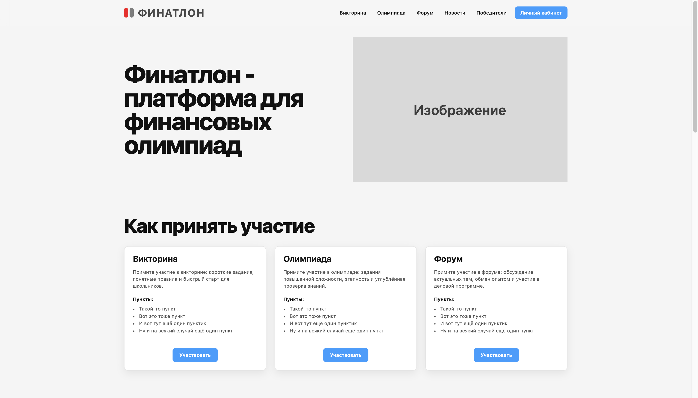

# Финатлон

Платформа для финансовых олимпиад, викторин и форума «Профессионалы будущего».
Это fullstack-приложение на React + Vite + Supabase:

- публичная часть (главная, новости, мероприятия, партнёры, документы);
- личный кабинет пользователя с редактированием профиля и историей участия;
- админ-панель с CRUD по всему пользовательскому контенту.



## Стек

- React 19 + TypeScript + Vite
- React Router 7
- Supabase (Postgres + Auth + RLS)
- CSS Modules

## Запуск локально

```sh
npm install
cp .env.example .env.local   # затем подставьте свои URL/anon key
npm run dev
```

Откройте `http://localhost:5173`.

## Проверка мобильной версии

Для браузерных проверок достаточно установить зависимости и браузер Playwright:

```sh
npm ci
npx playwright install chromium
npm run test:mobile
```

Тесты запускают отдельный локальный Vite-сервер и подменяют ответы Supabase тестовыми данными. Заполнять `.env.local` для этих тестов не требуется. Они проверяют публичные страницы с карточками на ширинах 320, 390 и 768 px, прокрутку меню на коротком экране и заполнение и закрытие формы регистрации. Тесты не создают учётные записи и не проверяют авторизацию на настоящем сервере.

## Полезные пути

- `/` — главная (контент из Supabase)
- `/news`, `/news/:slug` — новости
- `/events`, `/events/:slug` — мероприятия и таймлайн
- `/partners` — партнёры, организаторы, попечительский совет
- `/documents` — документы по категориям
- `/account/personal` — личный кабинет (требует входа)
- `/admin` — админ-панель (требует роль `admin`)

## Структура

```
src/
├── app/                # Корень приложения, роутер
├── pages/              # Страницы (HomePage, NewsListPage, AccountPage, AdminX...)
├── widgets/            # Сложные UI-блоки страниц
├── features/           # Фичи (AuthModal)
├── entities/           # Доменные типы (NewsArticle, Profile, ...)
└── shared/             # api, supabase client, ui-примитивы, lib, config
```

## Supabase

См. [SUPABASE.md](./SUPABASE.md) для информации по схеме, RLS и применению миграций.

## Проверки изменений

```sh
npm ci
npm run lint
npm run typecheck:api
npm run test:unit
npm run build
npx playwright install chromium
npm run test:mobile
```

CI выполняет эти проверки для pull request в `main` и при изменении `main`.
Браузерные тесты используют фиктивную авторизацию и перехваченные API-запросы,
не создают пользователей и не меняют production.

Раздел «Олимпиады и профили» поддерживает администрирование событий и результатов,
публичные карточки и описание условий. Автоматическая запись участника на конкретную
олимпиаду и движок тестирования пока не реализованы; ссылка ведёт в личный кабинет.
Перед включением записи в новом разделе примените аддитивную миграцию из [SUPABASE.md](./SUPABASE.md).
